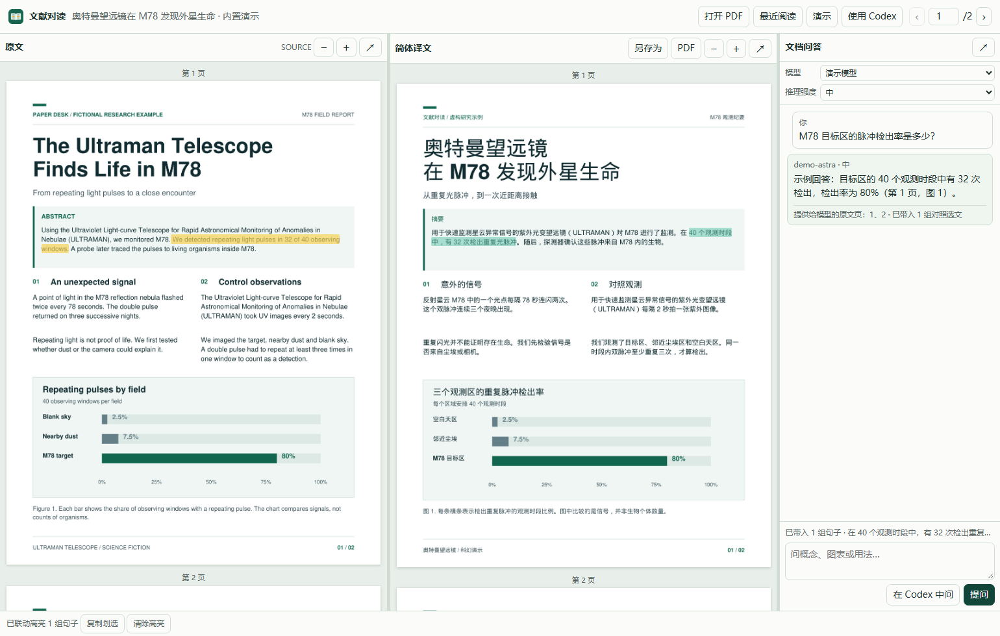

# 文献对读 · Paper Desk

**在 Codex 桌面里并排读英文 PDF 和简体中文译文，划选一句，两边一起高亮，还能就原文提问。**

适合精读英文论文、教材和技术手册。全文翻译和文档问答都复用已有的 Codex 登录，支持分别选择模型和推理强度，无需单独申请 API Key 或配置模型服务地址。



*内置演示《奥特曼望远镜在 M78 发现外星生命》是一篇虚构论文。任务、仪器、观测结果和截图中的问答均为演示。*

## 能做什么

| 功能 | 使用方式 |
| --- | --- |
| 三栏对读 | 原文、译文、问答同屏。两个 PDF 栏连续滚动并同步页码，可分别缩放；拖动分隔线调整宽度。 |
| 双向高亮 | 在原文或译文中拖选文字，另一栏会高亮能匹配的句子或语段。选文可以直接带入问答。 |
| 全文翻译 | 手动选择模型和推理强度后开始。按原文顺序翻译为简体中文，尽量保留页码、图表、公式和页面布局。可查看进度、取消任务或将译文另存为 PDF。 |
| 文档问答 | 结合当前页、相关原文和划选内容回答，显示处理阶段和交给模型的原文页码。可独立选择问答模型和推理强度。 |
| 最近阅读 | 按标题找回文档，从上次页码继续，并查看保存的译文和问答。翻译与问答设置分别按文档记忆。 |
| 独立窗口 | 点击栏标题旁的 **↗** 将原文、译文或问答弹出，拖到副屏即可。弹窗与主阅读器共享页码、高亮和问答。 |

## 安装

**当前安装方式面向 Windows。** 需要 [Codex 桌面版](https://openai.com/codex/)、[Node.js](https://nodejs.org/) 22 或更新版本，以及带 `pip` 的 [Python](https://www.python.org/downloads/) 3.10–3.13（建议 3.13）。独立窗口使用 Microsoft Edge。

1. 在 GitHub 仓库页面点击 **Code → Download ZIP** 并解压，或克隆仓库。把项目放在准备长期保留的目录：安装后的插件会从这里启动。
2. 在项目根目录打开 PowerShell，执行：

   ```powershell
   .\setup.ps1 -InstallPlugin
   ```

   首次安装会联网下载 PDF 渲染和排版组件、生成本机配置并注册本地插件。若 Windows 因下载标记阻止脚本，在检查脚本内容后可用 `Unblock-File -LiteralPath .\setup.ps1` 解除该文件的阻止，再执行安装命令。

3. 重启 Codex，在侧栏打开 **文献对读**。点击 **试读内置演示**，可在不调用模型的情况下体验双栏滚动和联动高亮。首次翻译可能还需要下载排版模型和字体。

只想阅读、导入现成译文或使用文档问答，可用 `.\setup.ps1 -InstallPlugin -SkipTranslator` 跳过自动翻译所需的排版组件。之后要启用自动翻译，再运行完整安装命令。

更新时，在原项目目录更新源码，再运行同一安装命令并重启 Codex。保留原目录中的 `.paper-desk/` 即可继续使用已有阅读记录。如果更新后首次启动弹出 JavaScript 错误，请看[已知问题](#已知问题)。

## 使用方法

1. **打开 PDF。** 在阅读器里点 **打开 PDF** 或拖入文件；也可以在 Codex 聊天里发送附件并说「用文献对读打开这个 PDF」。如果阅读器无法拿到聊天附件，请直接拖入本地文件。
2. **生成或导入译文。** 导入文档后先显示原文。要翻译时，在译文栏选择 **翻译模型** 和 **推理强度**，再点 **开始翻译**。已有中文 PDF 时可点 **导入译文**；请选择同一份文档、页数和页序一致、带可选文字的简体中文 PDF。
3. **边看边问。** 如需引用某个定义、图注或命令，先在任一栏划选，再在 **文档问答** 中输入问题。例如：「这个参数改成 0 会怎样？请给出处。」右栏提问会显示 **思考中** 和读取、生成、保存等阶段；回答会标出本次输入参考了哪些原文页。若点 **在 Codex 中问**，问题和原文片段会放入当前 Codex 聊天的草稿，由你发送，并使用该聊天自己的模型设置。
4. **保存和继续读。** 译文完成后，点译文栏的 **PDF** 可打开译文，点 **另存为** 可选择文件夹和文件名。下次从 **最近阅读** 选择 **继续阅读** 或 **查看问答**，就能找回对应内容。

「Codex 默认」指本机 Codex 配置的默认模型。译文和问答各有自己的选择器，只列出当前模型支持的推理档位。全文翻译会分批调用 Codex，长教材建议先用一小段测试效果、耗时和用量。

## 文件存在哪里？会发送什么？

- **本机文件：** 导入的原文会复制一份到项目下的 `.paper-desk/`，译文、阅读页码、模型选择和问答也保存在这里。原 PDF 不会被改写；另存为只是导出译文副本。建议单独备份这个目录。
- **模型输入：** PDF 渲染、句子配对和译文排版在本机完成。开始翻译时，抽取的文字会分批交给 Codex；使用文档问答时，会提交问题、相关原文、划选和部分近期问答。直接阅读或导入现成译文不会调用模型。
- **发布与反馈：** `.gitignore` 已排除 `.paper-desk/`、运行环境、测试输出和本机配置。提交问题时请用可公开的最小示例；截图或日志请先检查是否包含文档内容、文件路径或凭据。

## 已知问题

**更新插件后，第一次重启 Codex 会弹出 JavaScript 错误。** 这个现象在当前安装环境中已反复出现；退出 Codex 再打开一次，阅读器便恢复正常。原因尚未确认。如果遇到同样的问题，可以先记下弹窗里的完整报错，再重启一次；反馈时请附上报错、Codex 版本和插件版本。

## 使用限制

- 阅读器支持 PDF，通过界面选择或拖入的单个文件上限为 100 MiB。扫描件需先做 OCR 才能翻译或划选；网页与 EPUB 需先转为 PDF。
- 同一阅读器一次只能翻译一份文档。译文会按中文长度重新换行；复杂多栏、跨页句、代码块、表格和图内文字可能排版或对齐不准。无法可靠匹配时，只高亮选中侧；临时高亮不会写成 PDF 批注。
- 问答中的「原文页」是交给模型的参考范围；关键结论请回到原页核对。退出 Codex 后，独立窗口需从阅读器重新弹出。

## 项目结构与验证

- [setup.ps1](setup.ps1)：安装依赖、生成本机连接配置、注册并安装插件。
- [marketplace/plugins/paper-desk/](marketplace/plugins/paper-desk/)：插件清单、阅读器、MCP 服务、PDF 处理和内置 Skill。
- [tests/](tests/)：双语对齐、阅读器交互、阅读历史、模型选择和翻译的回归检查。

安装后，可先用内置演示验证三个栏位、页码同步及双向高亮。维护时可在项目根目录运行以下检查：

```powershell
node tests/codex-discovery.mjs
$env:PYTHONPATH = (Resolve-Path .runtime).Path
python tests/alignment.py
```

第一条检查已安装插件能否被 Codex 后端发现，第二项检查分栏阅读顺序与双语对齐。要跑浏览器回归，可用 `npm install --prefix .\test-output\browser --no-save playwright-core` 安装测试依赖，再执行 `node tests/browser.mjs`。模型选择、历史问答和翻译的实测脚本会调用当前 Codex 账户；其中浏览器回归使用模拟回答。

欢迎在仓库的 **Issues** 中反馈问题。请带上 Windows、Codex 和插件的版本，以及操作步骤、实际表现和预期表现。

## 依赖与许可证

文献对读源码采用 [GNU Affero General Public License v3.0](LICENSE)（`AGPL-3.0-only`）。任何人都可以使用、研究、修改和再发布，也可以商用。分发修改版本，或通过网络提供修改后的程序供用户交互时，须按许可证条款向相应用户提供对应源码。

文献对读使用 [PyMuPDF](https://pymupdf.readthedocs.io/) 渲染 PDF，使用 [PDFMathTranslate-next](https://github.com/PDFMathTranslate-next/PDFMathTranslate-next) 和 [BabelDOC](https://github.com/funstory-ai/BabelDOC) 保留版式并生成译文。插件集成参考 [OpenAI 插件扩展文档](https://developers.openai.com/plugins/build/extensions)。

上游依赖分别适用各自的许可证：PyMuPDF 提供 AGPL-3.0 或商业许可；PDFMathTranslate-next 与 BabelDOC 使用 AGPL-3.0。
